#G0

ПРИЛОЖЕНИЯ

ПРИЛОЖЕНИЕ К #M12293 0 1200001626 1540216064 78 81 964829291 914722912 2605865010 3458770026 3241465237ГЛ. 2.5#S.

УКАЗАНИЯ ПО ПРОЕКТИРОВАНИЮ ОПОР, ФУНДАМЕНТОВ И ОСНОВАНИЙ ВЛ 

Общие положения. Сочетания нагрузок

1. Конструкции опор, фундаментов и оснований ВЛ должны проектироваться в соответствии со СНиП Госстроя России с учетом настоящих Указаний, составленных применительно к расчету по методу предельных состояний и отражающих особенности проектирования конструкций ВЛ.

2. Опоры, фундаменты и основания ВЛ должны рассчитываться на нагрузку от собственного вeca и ветровую нагрузку на конструкции, на нагрузки oт проводов, тросов и оборудования ВЛ, а также на нагрузки, обусловленные принятым способом монтажа, на нагрузки oт веса монтера и монтажных приспособлений. Опоры, фундаменты и основания должны рассчитываться также на нагрузки и воздействия, которые мoгут действовать в конкретных условиях, например давление воды, давление льда, размывающее действие воды, давление грунта и т.п., которые принимаются и соответствии с указаниями СНиП Госстроя России или других нормативных документов.

3. Основными характеристиками нагрузок и воздействий являются их нормативные значения, которые устанавливаются в соответствии с требованиями 2.5.88-2.5.95 и п.5-8 настоящего приложения, а для нагрузок, не регламентированных указанными требованиями, в соответствии со #M12291 1200001601СНиП 2.01.07-85#S Госстроя России и другими нормативными документами, утвержденными или согласованными Госстроем России.

4. Возможное отклонение нагрузок в неблагоприятную (большую или меньшую) сторону oт их нормативных значений вследствие изменчивости нагрузок или отступлений oт условий нормальной эксплуатации учитывается коэффициентом перегрузки 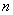.

5. Расчет опор, фундаментов и оснований ВЛ по прочности и устойчивости должен производиться на расчетные нагрузки, получаемые умножением нормативных нагрузок на коэффициенты перегрузок, а в случаях, указанных в п.9, - и на коэффициенты сочетаний.

Расчет опор, фундаментов и их элементов на выносливость и по деформациям производится на нормативные нагрузки. Расчет оснований по деформациям производится на нормативные нагрузки, вычисленные без учета динамического воздействия порывов ветра на конструкцию опоры (см. п. 13).

6. В зависимости от продолжительности действия нагрузок они подразделяются на постоянные и временные (длительные, кратковременные, особые).

К постоянным нагрузкам относятся нагрузки от собственного веса строительных конструкций, проводов, тросов и оборудования ВЛ, oт тяжения проводов и тросов при среднегодовой температуре и отсутствии ветра и гололеда, от веca и давления грунтов, oт давления воды на фундаменты в руслах рек, а также от воздействия предварительного напряжения конструкций.

К длительным нагрузкам относятся нагрузки, создаваемые воздействием неравномерных деформаций оснований, не сопровождающихся изменением структуры грунта, а также воздействием усадки и ползучести бетона.

К кратковременным нагрузкам относятся нагрузки от давления ветра на опоры, провода и тросы, oт веса гололеда на проводах и тросах, от дополнительного тяжения проводов и тросов сверх их значений при среднегодовой температуре; от давления воды на опоры и фундаменты в поймах рек и от давления льда, нагрузки, возникающие при изготовлении и перевозке конструкций, а также при монтаже конструкций, проводов и тросов.

К особым нагрузкам относятся нагрузки, возникающие при обрыве проводов и тросов, а также при сейсмических воздействиях.

7. Опоры, фундаменты и основания ВЛ следует рассчитывать на сочетания нагрузок, действующих в нормальных, аварийных и монтажных режимах, причем в монтажных режимах - с учетом возможности временного усиления отдельных элементов конструкций.

Сочетания климатических и других факторов в различных режимах работы конструкции ВЛ (наличие ветра, гололеда, значение температуры, количество оборванных проводов или тросов и пр.) определяются в соответствии с требованиями 2.5.34-2.5.36, 2.5.88-2.5.95.

Конструкции опор и фундаментов ВЛ должны также рассчитываться:

железобетонные опоры: по образованию трещин на действие нормативных постоянных нагрузок (весовых и oт тяжения проводов и тросов при среднегодовой температуре при отсутствии ветра и гололеда); по раскрытию трещин в нормальных режимах на действие нормативных постоянных нагрузок и сниженных на 10% кратковременных нормативных нагрузок;

деревянные опоры: по прочности на действие постоянных нагрузок;

железобетонные фундаменты: по раскрытию трещин в нормальных режимах на действие нормативных постоянных нагрузок и сниженных на 10% кратковременных нормативных нагрузок.

8. Сочетания нагрузок в нормальных и монтажных режимах работы ВЛ относятся к основным сочетаниям, а в аварийных режимах и при сейсмических воздействиях - к особым сочетаниям.

9. При расчете опор, фундаментов и оснований ВЛ по прочности и устойчивости (первая группа предельных состояний) в аварийных режимах и при сейсмических воздействиях расчетные нагрузки от веса гололеда, ветровые нагрузки на опоры, провода и тросы и от тяжения проводов и тросов умножаются на коэффициенты сочетаний:

а) в режимах обрыва проводов и тросов: 0,8 - при расчете промежуточных опор с поддерживающими гирляндами, их фундаментов и оснований; 1,0 - при расчете промежуточных опор со штыревыми изоляторами, их фундаментов и оснований; 0,95 - при расчете анкерных опор, их фундаментов и оснований;

б) при воздействии сейсмических нагрузок - 0,8.

Нормативные нагрузки

10. Нормативные вертикальные нагрузки  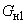, даН, от веса проводов и тросов определяются по формуле

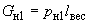,

где 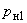 - нормативный вес провода или троса длиной 1 м, который принимается численно равным массе, кг, указанной в ГОСТ или технических условиях; 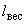 - весовой пролет, м.

При определении нагрузок от веса проводов и тросов для промежуточных опор, не отнесенных к конкретным условиям их установки (типовые, унифицированные опоры и т. п.), длину весового пролета рекомендуется принимать равной 1,25 длины габаритного пролета.

При определении нагрузок от веса проводов и тросов для расчета конструкций фундаментов промежуточных опор, не привязанных к конкретным условиям их установки, анкерных болтов на растяжение, оснований на вырывание и других элементов, условия работы которых утяжеляются при уменьшении весовой нагрузки от проводов и тросов, длину весового пролета рекомендуется принимать равной 0,75 длины габаритного пролета.

11. Нормативные вертикальные нагрузки 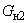, даН, от веса гололеда на проводах и тросах определяются по формуле

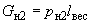,

где 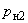 - нормативный вес гололедных отложений на 1 м провода или тpoca, который принимается численно равным массе, кг, определяемой в соответствии с 2.5.22, 2.5.31 и 2.5.32.

12. Нормативная вертикальная нагрузка 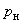, даН/м, отвеса гололеда, образующегося на конструкциях опор, определяется но формуле

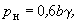

где  - толщина стенки гололеда, мм, принимаемая в соответствии с 2.5.22, 2.5.31 и 2.5.32 с учетом поправочного коэффициента на высоту, указанного #M12291 1200001601СНиП 2.01.07-85#S "Нагрузки и воздействия" Госстроя России; 0,6 - коэффициент, который учитывает отношение площади поверхности элемента сооружения, подверженной обледенению, к полной площади поверхности элемента; 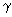 - плотность гололеда, принимаемая равной 0,9 г/см.

При высоте расположения приведенного центра тяжести проводов до 25 м гололедные отложения на конструкциях опор не учитываются.

13. Нормативная ветровая нагрузка на конструкции опор BЛ определяется как сумма статической и динамической составляющих.

Динамическая составляющая ветровой нагрузки на опоры учитывается при любых значениях периода собственных колебаний конструкции.

Нормативное значение статической составляющей ветровой нагрузки при направлении ветра, перпендикулярном продольной оси элемента или плоскости фермы, 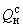, даН, определяется по формуле

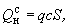

где q - скоростной напор ветра, даН/м, в рассматриваемом режиме работ BЛ, определяемый в соответствии с 2.5.22, 2.5.23, 2.5.26-2.5.28, 2.5.35, 2.5.36 и 2.5.89; с - аэродинамический коэффициент, определяемый для плоских ферм, пространственных решетчатых конструкций и отдельных элементов по указаниям #M12291 1200001601СНиП 2.01.07-85#S; 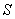- площадь элемента или площадь фермы, м, вычисленная по ее наружному габариту с учетом обледенения конструкции но указаниям п. 12 в гололедных режимах.

Определение ветровой нагрузки при других направлениях ветрового потока принимается по справочным и экспериментальным данным.

Для опор высотой до 50 м значение динамической составляющей ветровой нагрузки допускается принимать:

для свободностоящих одностоечных стальных опор 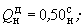*

для свободностоящих портальных опор 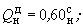*

___________________

* Текст приведен в соответствии с оригиналом. Примечание "Кодекс".

для стальных и железобетонных опор с оттяжками при шарнирном креплении к фундаментам 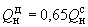.

Нормативное значение динамической составляющей ветровой нагрузки для свободностоящих опор высотой более 50 м определяется в соответствии с указаниями #M12291 1200001601СНиП 2.01.07-85#S.

При расчете свободностоящих железобетонных опор динамическая составляющая ветровой нагрузки не учитывается, если изгибающий момент со статической составляющей ветровой нагрузки на конструкцию опоры составляет не более 20% суммарного момента от воздействия ветровых нагрузок на опору, провода и грозозащитные тросы.

В расчетах деревянных опор динамическая составляющая не учитывается.

14. Нормативная ветровая нагрузка на провода и тросы, воспринимаемая опорами, определяется по формуле, указанной в 2.5.30. При этом площадь диаметрального сечения провода или троса определяется при длине, равной длине ветрового пролета.

При проектировании промежуточных опор и фундаментов, не привязанных к конкретным условиям их установки (типовых, унифицированных и т. п.), длину ветрового пролета рекомендуется принимать равной длине габаритного пролета.

Расчетные нагрузки и коэффициенты перегрузки

15. Расчетные нагрузки определяются умножением нормативных нагрузок на коэффициенты перегрузки с учетом указаний п. 5 и 9.

При расчете конструкций опор, фундаментов и оснований по первой группе предельных состояний (на прочность и устойчивость) коэффициенты перегрузки  должны приниматься по таблице.

При расчете опор, фундаментов и оснований в монтажных режимах на все виды нагрузок вводится единый коэффициент перегрузки = 1,1, за исключением нагрузок от массы монтера и монтажных приспособлений, для которых коэффициент пepeгpyзки принимается равным 1,3.

16. Новые типы массовых опор и фундаментов подлежат проверке испытанием опытных образцов.

Коэффициенты перегрузки

| #G0Наименование нагрузки  | Коэффициент перегрузки |
| --- | --- |
| От собственного веса строительных конструкций, проводов, тросов и оборудования ВЛ | 1,1 (0,9)* |
| От веса гололеда на проводах и тросах | 2,0  |
| От веса гололеда на конструкции опоры | 1,3  |
| Ветровая на конструкции опор: |  |
| при отсутствии гололеда на проводах и тросах  | 1,2  |
| при наличии гололеда на проводах и тросах | 1,0 (1,2)** |
| Ветровая на провода и тросы: |      |
| свободные от гололеда | 1,2  |
| покрытые гололедом | 1,4  |
| Горизонтальные нагрузки от тяжения проводов и тросов, свободных от гололеда или покрытых гололедом | 1,3 (1,5)*** |
| От веса монтеров и монтажных приспособлений | 1,3  |

_____________________________

* Значение, указанное в скобках, должно приниматься в случае, когда уменьшение вертикальной постоянной нагрузки ухудшает условия работы конструкции (например, при расчете анкерных болтов, фундаментов и оснований при выдергивании).

** Значение, указанное в скобках, принимается в случае учета гололедных отложений на конструкциях опор.

*** Значение, указанное в скобках, принимается для проводов с креплением на штыревых изоляторах.

ПРИЛОЖЕНИЕ 1

(СПРАВОЧНОЕ) К #M12293 0 1200001648 1540216064 83 79 2456983000 4294956598 2602951891 870496077 2612027816ГЛ. 7.3#S

КАТЕГОРИИ И ГРУППЫ ВЗРЫВООПАСНЫХ СМЕСЕЙ

 ПО ПИВРЭ И ПИВЭ 

До введения в действие стандартов на взрывозащищенное электрооборудование последнее разрабатывается и маркируется по "Правилам изготовления взрывозащищенного и рудничного электрооборудования" (ПИВРЭ) ОАА.684.053 -67. Кроме того, в эксплуатации имеется электрооборудование, разработанное и маркированное по "Правилам изготовления взрывозащищенного электрооборудования (ПИВЭ), утвержденным в 1960 и 1963 гг.

 Таблица П1.1

Категории  взрывоопасных смесей

| #G0Категория  | Критический зазор, мм  |
| --- | --- |
| 1  | Более 1,00 |
| 2  | От 0,65 до 1,00 |
| 3  | Oт 0,35 до 0,65 |
| 4  | До 0,35 |

Таблица П1.2 

 Группы взрывоопасных смесей по ПИВРЭ ОАА.684.053-67

| #G0Группа  | Температура самовоспламенения, °С  |
| --- | --- |
| Т1  | Более 450 |
| Т2  | " 300 до 450 |
| ТЗ  | " 200 до 300 |
| Т4  | " 135 до 200 |
| Т5  | " 100 до 135 |

Таблица П1.3 

Группы взрывоопасных смесей по ПИВЭ

| #G0Группа  | Температура самовоспламенения, °С  |
| --- | --- |
| А  | Более 450 |
| Б  | " 300 до 450 |
| Г  | " 175 до 300 |
| Д  | " 120 до 175 |

1. Категории взрывоопасных смесей по ПИВРЭ ОАА.684.053-67 и ПИВЭ, утвержденным в 1960 и 1963 гг., приведены в табл. П1.1.

Указанные в табл. П1.1 значения критического зазора непригодны для контроля ширины щели взрывонепроницаемых оболочек в эксплуатации.

Контроль параметров взрывозащиты взрывозащищенного электрооборудования необходимо производить по чертежам средств взрывозащиты, имеющимся в эксплуатационных документах на конкретное взрывозащищенное электрооборудование, а при их отсутствии следует руководствоваться гл. 3.4 "Электроустановки во взрывоопасных зонах" #M12293 0 1200001608 584910322 1645840020 2456984258 3768905123 3792932920 545347860 4096805460 2836092392ПЭЭП#S и #M12293 1 1200003217 584910322 2536943528 1061002212 4292890472 1645840020 2456984258 3768905123 7910603ПТБ#S при эксплуатации электроустановок потребителей.

2. Группы взрывоопасных смесей по ПИВРЭ ОАА.684.053 -67 приведены в табл. П1.2.

3. Группы взрывоопасных смесей по ПИВЭ приведены в табл. П1.3.

4. При выборе электрооборудования с маркировкой по взрывозащите по ПИВРЭ ОАА.684.053-67 и по ПИВЭ взрывозащищенность электрооборудования для взрывоопасных смесей определяется по табл. П1.4 и П1.5.

 Таблица П1.4

| #G0Категория взрывоопасной смеси по классификации ПИВРЭ и ПИВЭ  | Категория взрывоопасной смеси по #M12291 871001049ГОСТ 12.1.011-78#S, для которой электрооборудование является взрывозащищенньм  |
| --- | --- |
| 1  | IIА |
| 2  | IIА |
| 3  | IIА, IIB |
| 4  | IIА, IIB, IIС |

Таблица П1.5 

| #G0Группа взрывоопасной смеси в маркировке по взрывозащите электрооборудования, изготовленного по  | Группа взрывоопасной смеси по #M12291 871001049ГОСТ 12.1.011-78#S, для которой электрооборудование является взрывозащищенным  |  |
| --- | --- | --- |
| ПИВРЭ  | ПИВЭ  |    |
| Т1  | А  | Т1 |
| Т2  | Б  | Т1, Т2 |
| Т3  | - | Т1-ТЗ |
| Т4  | Г  | Т1-Т4 |
| Т5  | Д  | Т1-Т5 |

[Исходная структура таблицы](assets/table_6bd19aa91f6e6b9c.xml)

5. Взрывозащищенное электрооборудование, выполненное по ПИВРЭ или ПИВЭ для 2-й категории (цифра 2 в маркировке по взрывозащите), допускается применять во взрывоопасных смесях категории IIB (указаны в табл. 7.3.3), за исключением взрывоопасных смесей с воздухом коксового газа (IIBT1), окиси пропилена (IIBT2), окиси этилена (IIBT2), формальдегида (IIBT2), этилтрихлорсилана (IIBT2), этилена (IIBT2), винилтрихлорсилана (IIBT3) и этилдихлорсилана (IIПТЗ). Возможность применения указанного электрооборудования во взрывоопасных смесях категории IIB, не перечисленных в табл. 7.3.3, необходимо согласовать с испытательными организациями.

6. Взрывозащищенное электрооборудование, имеющее в маркировке по взрывозащите обозначение 4а и изготовленное по ПИВРЭ, не является взрывозащищенным для взрывоопасных смесей с воздухом ацетилена, метилдихлорсилана и трихлорсилана.

7. При выборе электрооборудования, имеющего взрывонепроницаемую оболочку и изготовленного по ПИВЭ, для взрывоопасных смесей категории IIC необходимо руководствоваться инструкциями по монтажу и эксплуатации на конкретные изделия, в которых указывается, для каких именно взрывоопасных смесей категории IIC электрооборудование является взрывозащищенным.

8. Электрооборудование, изготовленное по ПИВЭ и имеющее в маркировке по взрывозащите обозначение А, является также взрывозащищенным и для взрывоопасных смесей группы Т2, температура самовоспламенения которых выше 360 °С, а электрооборудование, имеющее в маркировке по взрывозащите обозначение Б, является взрывозащищенным и для взрывоопасных смесей группы ТЗ, температура самовоспламенения которых выше 240 °С.

9. Электрические машины и аппараты с видом взрывозащиты "взрывонепроницаемая оболочка" в средах со взрывоопасными смесями категории 4 по классификации ПИВРЭ и ПИВЭ должны быть установлены так, чтобы взрывонепроницаемые фланцевые зазоры не примыкали вплотную к какой-либо поверхности, а находились от нее на расстоянии не менее 50 мм

ПРИЛОЖЕНИЕ 2

(СПРАВОЧНОЕ) К #M12293 0 1200001648 1540216064 83 79 2456983000 4294956598 2602951891 870496077 2612027816ГЛ. 7.3#S

МАРКИРОВКА ВЗРЫВОЗАЩИЩЕННОГО ЭЛЕКТРООБОРУДОВАНИЯ ПО ПИВРЭ

1. Взрывозащищенное электрооборудование имеет маркировку с указанием:

а) уровня взрывозащиты;

б) наивысшей категории и наивысшей группы взрывоопасной смеси, для которой электрооборудование является взрывозащищенным;

в) вида или видов взрывозащиты;

2. Маркировка выполняется непосредственно на электрооборудовании в прямоугольной и круглой рамках

В прямоугольной рамке обозначаются уровень взрывозащиты, категория и группа взрывозащитной смеси.

На первом месте обозначается буквой уровень взрывозащиты электрооборудования.

Повышенной надежности против взрыва +++++++++ Н 

Взрывобезопасное +++++++++++++...+++++.  В 

Особовзрывобезопасное +++++++++++..+++++ О

На втором  - четвертом местах обозначаются категории и группа взрывоопасной смеси - категория - цифрой согласно табл П1.1, группа  - буквой Т и цифрой согласно табл. П1.2.

В круглой рамке обозначается буквой вид (или виды) взрывозащиты:

Взрывонепроницаемая оболочка ++++++++..........++++++ В

Заполнение или продувка оболочки под избыточным давлением +. П

Искробезопасная электрическая цепь ++++++++.........++++ И

Кварцевое заполнение оболочки +++++++++++++...........+. К

Масляное заполнение оболочки ++++++++++++++............. М

Автоматическое отключение от источника электроэнергии .......+.++ А

Специальный вид взрывозащиты ++++++++++...........++.++.С

Повышенная надежность против взрыва (защита вида "е") +.......++ Н

Примеры маркировки взрывозащищенного электрооборудования по ПИВРЭ приведены в табл. П2.1.

 Таблица П2.1 

 Примеры маркировки взрывозащищенного электрооборудования по ПИВЭ 

| #G0Уровень взрывозащиты электро-оборудования  | Видвзрывозащиты  | Категория и группа взрывоопасной смеси, для которой предназначено электро-оборудование  | Маркировка по взрывозащите  |
| --- | --- | --- | --- |
| Электрооборудование повышенной надежности против взрыва | Защита вида "е" | Все категории группы Т1  - Т4  |    |
|  | Защита вида "е" и взрывонепроницаемая оболочка  | 1-я и 2-я катего рии, группы Т1  -ТЗ  | 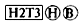   |
|  | Защита вида "е" и искробезопасная электрическая цепь | Все категории и группы  | 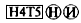   |
|  | Масляное заполнение оболочки и защита вида "е" | То же  |    |
| Взрывобезопасное электрооборудование  | Взрывонепроницаемая оболочка  | 1-я и 2-я катего- рии, группыТ1-ТЗ  |    |
|  | Искробезопасная электрическая цепь | Все категории и группы  | 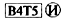   |
|  | Кварцевое заполнение оболочки | Все категории, группа Т1  |    |
|  | Заполнение или продувка оболочки под избыточным давлением | Все категории, группы Т1  - Т4  |    |
|  | Масляное заполнение оболочки  | Все категории и группы  |    |
|  | Специальный вид взрывозащиты | Все категории, группы Т1  - Т4  |    |
|  | Взрывонепроницаемая оболочка и искробезопасная электрическая цепь | Все категории, группы Т1  - ТЗ  | 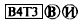   |
|  | Взрывонепроницаемая оболочка, искробезопасная электрическая цепь и специальный вид взрывозащиты | Все категории и группы  |    |
|    | Искробезопасная электрическая цепь и специальный вид взрывозащиты | 1-я категория, все группы  |    |
| Особовзрывобезопасное электрооборудование      | Искробезопасная электрическая цепь  | Все категории и группы  |    |

ПРИЛОЖЕНИЕ 3

(СПРАВОЧНОЕ) К #M12293 0 1200001648 1540216064 83 79 2456983000 4294956598 2602951891 870496077 2612027816ГЛ. 7.3#S

МАРКИРОВКА ВЗРЫВОЗАЩИЩЕННОГО ЭЛЕКТРООБОРУДОВАНИЯ ПО ПИВЭ

Электрооборудование, изготовленное по ПИВЭ, на уровни взрывозащиты не подразделяется.

Виды взрывозащиты электрооборудования в маркировке по взрывозащите обозначаются теми же буквами, что и по ПИВРЭ ОАА.684.058-67 (см. приложение 2, п.2).

     В маркировку по взрывозащите электрооборудования в указанной ниже последовательности входят:

     а) обозначение вида взрывозащиты;

б) обозначение наивысшей категории взрывоопасной смеси, для которой электрооборудование является взрывозащищенным (согласно табл. П1.1), если взрывозащита электрооборудования или отдельных его частей обеспечивается взрывонепроницаемой оболочкой; для электрооборудования с остальными видами взрывозащиты, являющегося взрывозащищенным для взрывоопасных смесей всех категорий, вместо обозначения категории взрывоопасной смеси ставится цифра 0;

     в) обозначение наивысшей группы взрывоопасной смеси, для которой электрооборудование является взрывозащищенным (согласно табл. П1.3).

Для электрооборудования с защитой вида "е" (повышенная надежность против взрыва) с искрящими частями, заключенными в оболочку, заполненную маслом или продуваемую под избыточным давлением, вместо цифры 0 ставится обозначение соответствующего вида взрывозащиты: М или П.

Для электрооборудования с видом взрывозащиты "искробезопасная электрическая цепь" указывается наименование горючего вещества, на котором оно испытано. Обозначение категории и группы для такого электрооборудования не проставляется.

Примеры маркировки взрывозащищенного электрооборудования по ПИВЭ приведены в табл. П3.1.

К уровню "электрооборудование повышенной надежности против взрыва" относится электрооборудование, имеющее в маркировке по взрывозащите букву Н, а также цифру 2 перед буквой И, например:

МНБ, НОГ, Н2А, НПД, НОА,  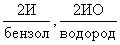 и т. п.

      Электрооборудование с остальными маркировками по взрывозащите, выполненными по ПИВЭ, следует относить к уровню "взрывобезопасное электрооборудование".

     Таблица П3.1

Примеры маркировки взрывозащищенного электрооборудования по ПИВЭ*

| #G0Вид взрывозащиты электрооборудования  | Категория и группа взрывоопасной смеси, для которых предназначено электрооборудование | Маркировка по взрывозащите  |
| --- | --- | --- |
| Взрывонепроницаемая оболочка  | 1-я категория, группа А | В1А  |
|  | 1-3-я категории, группы А, Б и Г | В3Г  |
|  | Все категории, группа А | В4А  |
| Масляное заполнение оболочки и взрывонепроницаемая оболочка  | 1-3-я категории, группа А | М3А  |
| Масляное заполнение оболочки и за- щита вида "е" | Все категории, группы А и Б | МНБ  |
| Защита вида "е" | Все категории, группы А, Б и Г | Н0Г  |
| Защита вида "е" и взрывонепроницаемая оболочка  | 1-я и 2-я категории, группа А | Н2А  |
| Защита вида "е" и заполнение или продувка оболочки под избыточным давлением | Все категории и группы | НПД  |
| Защита вида "е" и масляное заполнение оболочки | Все категории и группы | НМД  |
| Защита вида "е" и искробезопасная электрическая цепь | Все категории, группа А | Н0А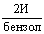 |
| Заполнение или продувка оболочки под избыточным давлением  | Все категории и группы | 110Д  |
| Искробезопасная электрическая цепь и взрывонепроницаемая оболочка | 1 -3-я категории, группы А, Б и Г  | 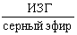  |
| Искробезопасная электрическая цепь  | Все категории и группы  | 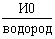       |
| Специальный вид взрывозащиты | Все категории, группы А, Б и Г  | С01  |
| Специальный вид взрывозащиты и искробезопасная электрическая цепь | Все категории и группы  | С0Д  |
| Взрывонепроницаемая оболочка и искробезопасная электрическая цепь | 1 -3-я категории, группы А, Б и Г  | 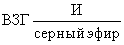         |

Текст документа сверен по:

официальное издание 

Главгосэнергонадзор России - 

М.: ЗАО "Энергосервис", 1998 
