#G0

Глава 1.9

ИЗОЛЯЦИЯ ЭЛЕКТРОУСТАНОВОК

    Дата введения 2003-01-01

Предисловие

РАЗРАБОТАНО с учетом требований государственных стандартов, строительных норм и правил, рекомендаций научно-технических советов по рассмотрению проектов глав. Проекты глав рассмотрены рабочими группами Координационного совета по пересмотру ПУЭ.

ПОДГОТОВЛЕНО ОАО "НИИПТ".

СОГЛАСОВАНО в установленном порядке с Госстроем России, Госгортехнадзором России, РАО "ЕЭС России" (ОАО "ВНИИЭ") и представлено к утверждению Госэнергонадзором Минэнерго России.

УТВЕРЖДЕНО Министерством энергетики Российской Федерации, приказ от 8 июля 2002 г. N 204.

"Правила устройства электроустановок" (ПУЭ) седьмого издания в связи с длительным сроком переработки выпускаются и вводятся в действие отдельными разделами и главами по мере завершения работ по их пересмотру, согласованию и утверждению.

Требования Правил устройства электроустановок обязательны для всех организаций независимо от форм собственности и организационно-правовых форм, а также для физических лиц, занятых предпринимательской деятельностью без образования юридического лица.  

Область применения. Определения 

1.9.1. Настоящая глава распространяется на выбор изоляции электроустановок переменного тока на номинальное напряжение 6-750 кВ.

1.9.2. Длина пути утечки изоляции (изолятора) или составной изоляционной конструкции (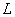) - наименьшее расстояние по поверхности изоляционной детали между металлическими частями разного потенциала.

1.9.3. Эффективная длина пути утечки - часть длины пути утечки, определяющая электрическую прочность изолятора или изоляционной конструкции в условиях загрязнения и увлажнения.

Удельная эффективная длина пути утечки (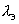) - отношение эффективной длины пути утечки к наибольшему рабочему межфазному напряжению сети, в которой работает электроустановка.

1.9.4. Коэффициент использования длины пути утечки (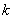) - поправочный коэффициент, учитывающий эффективность использования длины пути утечки изолятора или изоляционной конструкции.

1.9.5. Степень загрязнения (СЗ) - показатель, учитывающий влияние загрязненности атмосферы на снижение электрической прочности изоляции электроустановок.

1.9.6. Карта степеней загрязнения (КСЗ) - географическая карта, районирующая территорию по СЗ.

Общие требования 

1.9.7. Выбор изоляторов или изоляционных конструкций из стекла и фарфора должен производиться по удельной эффективной длине пути утечки в зависимости от СЗ в месте расположения электроустановки и ее номинального напряжения. Выбор изоляторов или изоляционных конструкций из стекла и фарфора может производиться также по разрядным характеристикам в загрязненном и увлажненном состоянии.

Выбор полимерных изоляторов или конструкций в зависимости от СЗ и номинального напряжения электроустановки должен производиться по разрядным характеристикам в загрязненном и увлажненном состоянии.

1.9.8. Определение СЗ должно производиться в зависимости от характеристик источников загрязнения и расстояния от них до электроустановки (табл.1.9.3-1.9.18). В случаях, когда использование табл.1.9.3-1.9.18 по тем или иным причинам невозможно, определение СЗ следует производить по КСЗ.

Вблизи промышленных комплексов, а также в районах с наложением загрязнений от крупных промышленных предприятий, ТЭС и источников увлажнения с высокой электрической проводимостью определение СЗ, как правило, должно производиться по КСЗ.

1.9.9. Длина пути утечки  (см) изоляторов и изоляционных конструкций из стекла и фарфора должна определяться по формуле

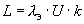,

где  - удельная эффективная длина пути утечки по табл.1.9.1, см/кВ;

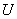 - наибольшее рабочее междуфазное напряжение, кВ (по #M12291 1200005016ГОСТ 721#S); 

 - коэффициент использования длины пути утечки (1.9.44-1.9.53).

Изоляция ВЛ 

1.9.10. Удельная эффективная длина пути утечки поддерживающих гирлянд изоляторов и штыревых изоляторов ВЛ на металлических и железобетонных опорах в зависимости от СЗ и номинального напряжения (на высоте до 1000 м над уровнем моря) должна приниматься по табл.1.9.1.

Таблица 1.9.1 

Удельная эффективная длина пути утечки поддерживающих гирлянд 

изоляторов и штыревых изоляторов ВЛ на металлических и железобетонных 

опорах, внешней изоляции электрооборудования и изоляторов ОРУ 

| #G0Степень загрязнения  | , см/кВ (не менее), при номинальном напряжении, кВ  |  |
| --- | --- | --- |
|  | до 35 включительно | 110-750  |
| 1 | 1,90  | 1,60  |
| 2 | 2,35  | 2,00  |
| 3 | 3,00  | 2,50  |
| 4 | 3,50  | 3,10  |

[Исходная структура таблицы](assets/table_c43775f3ae8b6297.xml)

Удельная эффективная длина пути утечки поддерживающих гирлянд и штыревых изоляторов ВЛ на высоте более 1000 м над уровнем моря должна быть увеличена по сравнению с нормированной в табл.1.9.1:

от 1000 до 2000 м - на 5%;

от 2000 до 3000 м - на 10%;

от 3000 до 4000 м - на 15%.

1.9.11. Изоляционные расстояния по воздуху от токоведущих до заземленных частей опор должны соответствовать требованиям гл.2.5.

1.9.12. Количество подвесных тарельчатых изоляторов в поддерживающих гирляндах и в последовательной цепи гирлянд специальной конструкции ( 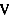-образных, -образных, -образных, -образных и др., составленных из изоляторов одного типа) для BЛ на металлических и железобетонных опорах должно определяться по формуле

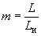,

где  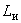 - длина пути утечки одного изолятора по стандарту или техническим условиям на изолятор конкретного типа, см. Если расчет  не дает целого числа, то выбирают следующее целое число.

1.9.13. На ВЛ напряжением 6-20 кВ с металлическими и железобетонными опорами количество подвесных тарельчатых изоляторов в поддерживающих и натяжных гирляндах должно определяться по 1.9.12 и независимо от материала опор должно составлять не менее двух.

На ВЛ напряжением 35-110 кВ с металлическими, железобетонными и деревянными опорами с заземленными креплениями гирлянд количество тарельчатых изоляторов в натяжных гирляндах всех типов в районах с 1-2-й СЗ следует увеличивать на один изолятор в каждой гирлянде по сравнению с количеством, полученным по 1.9.12.

На ВЛ напряжением 150-750 кВ на металлических и железобетонных опорах количество тарельчатых изоляторов в натяжных гирляндах должно определяться по 1.9.12.

1.9.14. На ВЛ напряжением 35-220 кВ с деревянными опорами в районах с 1-2-й СЗ количество подвесных тарельчатых изоляторов из стекла или фарфора допускается принимать на 1 меньше, чем для ВЛ на металлических или железобетонных опорах.

На ВЛ напряжением 6-20 кВ с деревянными опорами или деревянными траверсами на металлических и железобетонных опорах в районах с 1-2-й СЗ удельная эффективная длина пути утечки изоляторов должна быть не менее 1,5 см/кВ.

1.9.15. В гирляндах опор больших переходов должно предусматриваться по одному дополнительному тарельчатому изолятору из стекла или фарфора на каждые 10 м превышения высоты опоры сверх 50 м по отношению к количеству изоляторов нормального исполнения, определенному для одноцепных гирлянд при =1,9 см/кВ для ВЛ напряжением 6-35 кВ и =1,4 см/кВ для ВЛ напряжением 110-750 кВ. При этом количество изоляторов в гирляндах этих опор должно быть не менее требуемого по условиям загрязнения в районе перехода.

1.9.16. В гирляндах тарельчатых изоляторов из стекла или фарфора, подвешенных на высоте более 100 м, должны предусматриваться сверх определенного в соответствии с 1.9.12 и 1.9.15 два дополнительных изолятора.

1.9.17. Выбор изоляции ВЛ с изолированными проводами должен производиться в соответствии с 1.9.10-1.9.16.

Внешняя стеклянная и фарфоровая изоляция

электрооборудования и ОРУ 

1.9.18. Удельная эффективная длина пути утечки внешней фарфоровой изоляции электрооборудования и изоляторов ОРУ напряжением 6-750 кВ, а также наружной части вводов ЗРУ в зависимости от СЗ и номинального напряжения (на высоте до 1000 м над уровнем моря) должна приниматься по табл.1.9.1.

Удельная эффективная длина пути утечки внешней изоляции электрооборудования и изоляторов ОРУ напряжением 6-220 кВ, расположенных на высоте более 1000 м, должна приниматься: на высоте до 2000 м - по табл.1.9.1, а на высоте от 2000 до 3000 м - на одну степень загрязнения выше по сравнению с нормированной.

1.9.19. При выборе изоляции ОРУ изоляционные расстояния по воздуху от токоведущих частей ОРУ до заземленных конструкций должны соответствовать требованиям гл.4.2.

1.9.20. В натяжных и поддерживающих гирляндах ОРУ число тарельчатых изоляторов следует определять по 1.9.12-1.9.13 с добавлением в каждую цепь гирлянды напряжением 110-150 кВ - одного, 220-330 кВ - двух, 500 кВ - трех, 750 кВ - четырех изоляторов.

1.9.21. При отсутствии электрооборудования, удовлетворяющего требованиям табл.1.9.1 для районов с 3-4-й СЗ, необходимо применять оборудование, изоляторы и вводы на более высокие номинальные напряжения с изоляцией, удовлетворяющей табл.1.9.1.

1.9.22. В районах с условиями загрязнения, превышающими 4-ю СЗ, как правило, следует предусматривать сооружение ЗРУ.

1.9.23. ОРУ напряжением 500-750 кВ и, как правило, ОРУ напряжением 110-330 кВ с большим количеством присоединений не должны располагаться в зонах с 3-4-й СЗ.

1.9.24. Удельная эффективная длина пути утечки внешней изоляции электрооборудования и изоляторов в ЗРУ напряжением 110 кВ и выше должна быть не менее 1,2 см/кВ в районах с 1-й СЗ и не менее 1,5 см/кВ в районах с 2-4-й СЗ.

1.9.25. В районах с 1-3-й СЗ должны применяться КРУН и КТП с изоляцией по табл.1.9.1. В районах с 4-й СЗ допускается применение только КРУН и КТП с изоляторами специального исполнения.

1.9.26. Изоляторы гибких и жестких наружных открытых токопроводов должны выбираться с удельной эффективной длиной пути утечки по табл.1.9.1: =1,9 см/кВ на номинальное напряжение 20 кВ для токопроводов 10 кВ в районах с 1-3-й СЗ;  =3,0 см/кВ на номинальное напряжение 20 кВ для токопроводов 10 кВ в районах с 4-й СЗ; =2,0 см/кВ на номинальное напряжение 35 кВ для токопроводов 13,8-24 кВ в районах с 1-4-й СЗ.

Выбор изоляции по разрядным характеристикам 

1.9.27. Гирлянды ВЛ напряжением 6-750 кВ, внешняя изоляция электрооборудования и изоляторы ОРУ напряжением 6-750 кВ должны иметь 50%-ные разрядные напряжения промышленной частоты в загрязненном и увлажненном состоянии не ниже значений, приведенных в табл.1.9.2.

Таблица 1.9.2     

50%-ные разрядные напряжения гирлянд ВЛ 6-750 кВ, 

внешней изоляции электрооборудования и изоляторов 

ОРУ 6-750 кВ в загрязненном и увлажненном состоянии 

| #G0Номинальное напряжение электроустановки, кВ | 50%-ные разрядные напряжения, кВ (действующие значения) |
| --- | --- |
| 6 | 8  |
| 10 | 13  |
| 35 | 42  |
| 110 | 110  |
| 150 | 150  |
| 220 | 220  |
| 330 | 315  |
| 500 | 460  |
| 750 | 685  |

Удельная поверхностная проводимость слоя загрязнения должна приниматься (не менее):

для 1-й СЗ - 5 мкСм, 2-й СЗ -10 мкСм, 3-й СЗ - 20 мкСм, 4-й СЗ - 30 мкСм.

Определение степени загрязнения 

1.9.28. В районах, не попадающих в зону влияния промышленных источников загрязнения (леса, тундра, лесотундра, луга), может применяться изоляция с меньшей удельной эффективной длиной пути утечки, чем нормированная в табл.1.9.1 для 1-й СЗ.

1.9.29. К районам с 1-й СЗ относятся территории, не попадающие в зону влияния источников промышленных и природных загрязнений (болота, высокогорные районы, районы со слабозасоленными почвами, сельскохозяйственные районы).

1.9.30. В промышленных районах при наличии обосновывающих данных может применяться изоляция с большей удельной эффективной длиной пути утечки, чем нормированная в табл.1.9.1 для 4-й СЗ. 

1.9.31. Степень загрязнения вблизи промышленных предприятий должна определяться по табл.1.9.3-1.9.12 в зависимости от вида и расчетного объема выпускаемой продукции и расстояния до источника загрязнений.

Таблица 1.9.3 

СЗ вблизи химических предприятий и производств 

| #G0Расчетный объем выпускаемой продукции, тыс. т/год  | СЗ при расстоянии от источника загрязнения, м  |  |  |  |  |  |  |  |
| --- | --- | --- | --- | --- | --- | --- | --- | --- |
|  | до 500 | от 500 до 1000 | от 1000 до 1500 | от 1500 до 2000  | от 2000 до 2500  | от 2500 до 3000  | от 3000 до 5000  | от 5000  |
| До 10 | 1  | 1  | 1  | 1  | 1  | 1  | 1  | 1  |
| От 10 до 500 | 2  | 1  | 1  | 1  | 1  | 1  | 1  | 1  |
| От 500 до 1500 | 3  | 2  | 1  | 1  | 1  | 1  | 1  | 1  |
| От 1500 до 2500 | 3  | 3  | 2  | 1  | 1  | 1  | 1  | 1  |
| От 2500 до 3500 | 4  | 3  | 3  | 2  | 2  | 1  | 1  | 1  |
| От 3500 до 5000 | 4  | 4  | 3  | 3  | 3  | 2  | 2  | 1  |

[Исходная структура таблицы](assets/table_4c3ad845beeee7c0.xml)

Таблица 1.9.4 

СЗ вблизи нефтеперерабатывающих

и нефтехимических предприятий и производств 

| #G0Подотрасль  | Расчетный объем выпускаемой продукции, тыс. т/год  | СЗ при расстоянии от источника загрязнения, м  |  |  |  |  |  |
| --- | --- | --- | --- | --- | --- | --- | --- |
|  |  | до 500 | от 500 до 1000 | от 1000 до 1500 | от 1500 до 2000  | от 2000 до 3500  | от 3500  |
| Нефтепере- рабатывающие заводы  | До 1000  | 1  | 1  | 1  | 1  | 1  | 1  |
|  | От 1000 до 5000 | 2  | 1  | 1  | 1  | 1  | 1  |
|  | От 5000 до 9000 | 3  | 2  | 1  | 1  | 1  | 1  |
|  | От 9000 до 18000 | 3  | 3  | 2  | 1  | 1  | 1  |
| Нефтехими- ческие заводы и комбинаты  | До 5000  | 3  | 2  | 1  | 1  | 1  | 1  |
|  | От 5000 до 10000 | 3  | 3  | 2  | 1  | 1  | 1  |
|  | От 10000 до 15000 | 4  | 3  | 3  | 2  | 1  | 1  |
|  | От 15000 до 20000 | 4  | 4  | 3  | 3  | 2  | 1  |
| Заводы синтетического каучука  | От 50  | 1  | 1  | 1  | 1  | 1  | 1  |
|  | От 50 до 150 | 2  | 1  | 1  | 1  | 1  | 1  |
|  | От 150 до 500 | 3  | 2  | 1  | 1  | 1  | 1  |
|  | От 500 до 1000 | 3  | 3  | 2  | 1  | 1  | 1  |
| Заводы резинотехни- ческих изделий  | До 100  | 1  | 1  | 1  | 1  | 1  | 1  |
|  | От 100 до 300 | 2  | 1  | 1  | 1  | 1  | 1  |

[Исходная структура таблицы](assets/table_1f04fd8b0297a38c.xml)

Таблица 1.9.5 

СЗ вблизи предприятий по производству газов

и переработке нефтяного газа 

| #G0Подотрасль  | Расчетный объем выпускаемой продукции  | СЗ при расстоянии от источника загрязнения, м  |  |  |
| --- | --- | --- | --- | --- |
|  |  | до 500 | от 500 до 1000 | от 1000  |
| Производство газов | Независимо от объема | 2  | 1  | 1  |
| Переработка нефтяного газа | Независимо от объема | 3  | 2  | 1  |

[Исходная структура таблицы](assets/table_756d436e3801a1af.xml)

Таблица 1.9.6 

СЗ вблизи предприятий по производству целлюлозы и бумаги

| #G0Подотрасль  | Расчетный объем выпускаемой продукции, тыс. т/год  | СЗ при расстоянии от источника загрязнения, м  |  |  |  |
| --- | --- | --- | --- | --- | --- |
|  |  | до 500 | от 500 до 1000 | от 1000 до 1500 | от 1500  |
| Производство целлюлозы и полуцеллюлозы  | До 75  | 1  | 1  | 1  | 1  |
|  | От 75 до 150 | 2  | 1  | 1  | 1  |
|  | От 150 до 500 | 3  | 2  | 1  | 1  |
|  | От 500 до 1000 | 4  | 3  | 2  | 1  |
| Производство бумаги | Независимо от объема  | 1  | 1  | 1  | 1  |

[Исходная структура таблицы](assets/table_7217e63b4ed431c2.xml)

Таблица 1.9.7 

СЗ вблизи предприятий и производств черной металлургии 

| #G0Подотрасль  | Расчетный объем выпускаемой продукции, тыс. т/год  | СЗ при расстоянии от источника загрязнения, м  |  |  |  |  |  |
| --- | --- | --- | --- | --- | --- | --- | --- |
|  |  | до 500 | от 500 до 1000 | от 1000 до 1500 | от 1500 до 2000  | от 2000 до 2500  | от 2500  |
| Выплавка чугуна и стали  | До 1500  | 2  | 1  | 1  | 1  | 1  | 1  |
|  | От 1500 до 7500 | 2  | 2  | 2  | 1  | 1  | 1  |
|  | От 7500 до 12000 | 3  | 2  | 2  | 2  | 1  | 1  |
| Горнообога- тительные комбинаты  | До 2000  | 1  | 1  | 1  | 1  | 1  | 1  |
|  | От 2000 до 5500 | 2  | 1  | 1  | 1  | 1  | 1  |
|  | От 5500 до 10000 | 3  | 2  | 1  | 1  | 1  | 1  |
|  | От 10000 до 13000 | 3  | 3  | 2  | 1  | 1  | 1  |
| Коксохим- производство  | До 5000  | 2  | 2  | 2  | 2  | 2  | 1  |
|  | От 5000 до 12000 | 3  | 2  | 2  | 2  | 2  | 1  |
| Ферросплавы  | До 500 | 1  | 1  | 1  | 1  | 1  | 1  |
|  | От 500 до 700 | 2  | 2  | 1  | 1  | 1  | 1  |
|  | От 700 до 1000 | 3  | 3  | 2  | 1  | 1  | 1  |
| Производство магне- зиальных изделий | Независимо от объема  | 3  | 2  | 2  | 2  | 1  | 1  |
| Прокат и обработка чугуна и стали | Независимо от объема  | 2  | 1  | 1  | 1  | 1  | 1  |

[Исходная структура таблицы](assets/table_33049c274596e9cc.xml)

Таблица 1.9.8 

СЗ вблизи предприятий и производств цветной металлургии 

| #G0Подотрасль  | Расчетный объем выпускаемой продукции, тыс. т/год  | СЗ при расстоянии от источника загрязнения, м  |  |  |  |  |  |  |
| --- | --- | --- | --- | --- | --- | --- | --- | --- |
|  |  | до 500 | от 500 до 1000 | от 1000 до 1500 | от 1500 до 2000  | от 2000 до 2500  | от 2500 до 3500  | от 3500  |
| Производство алюминия  | До 100  | 1  | 1  | 1  | 1  | 1  | 1  | 1  |
|  | От 100 до 500 | 2  | 2  | 1  | 1  | 1  | 1  | 1  |
|  | От 500 до 1000 | 3  | 3  | 2  | 2  | 1  | 1  | 1  |
|  | От 1000 до 2000 | 3  | 3  | 3  | 2  | 2  | 1  | 1  |
| Производство никеля  | От 1 до 5 | 1  | 1  | 1  | 1  | 1  | 1  | 1  |
|  | От 5 до 25  | 2  | 2  | 1  | 1  | 1  | 1  | 1  |
|  | От 25 до 1000 | 3  | 2  | 2  | 1  | 1  | 1  | 1  |
| Производство редких металлов  | Независимо от объема | 4  | 4  | 3  | 3  | 2  | 2  | 1  |
| Производство цинка | Независимо от объема | 3  | 2  | 1  | 1  | 1  | 1  | 1  |
| Производ- ство и обработка цветных металлов | Независимо от объема | 2  | 1  | 1  | 1  | 1  | 1  | 1  |

[Исходная структура таблицы](assets/table_f80320dc91a87a75.xml)

Таблица 1.9.9 

СЗ вблизи предприятий по производству строительных материалов 

| #G0Подотрасль  | Расчетный объем выпускаемой продукции, тыс. т/год  | СЗ при расстоянии от источника загрязнения, м  |  |  |  |  |  |  |
| --- | --- | --- | --- | --- | --- | --- | --- | --- |
|  |  | до 250 | от 250 до 500 | от 500 до 1000 | от 1000 до 1500 | от 1500 до 2000  | от 2000 до 3000  | от 3000  |
| Производство цемента  | До 100  | 1  | 1  | 1  | 1  | 1  | 1  | 1  |
|  | От 100 до 500 | 2  | 2  | 1  | 1  | 1  | 1  | 1  |
|  | От 500 до 1500 | 3  | 3  | 2  | 1  | 1  | 1  | 1  |
|  | От 1500 до 2500 | 3  | 3  | 3  | 2  | 1  | 1  | 1  |
|  | От 2500 до 3500 | 4  | 4  | 3  | 3  | 2  | 1  | 1  |
| Производство асбеста и др. | Независимо от объема | 3  | 2  | 1  | 1  | 1  | 1  | 1  |
| Производство бетонных изделий и др. | Независимо от объема | 2  | 1  | 1  | 1  | 1  | 1  | 1  |

[Исходная структура таблицы](assets/table_69756b653a6bb75a.xml)

Таблица 1.9.10 

СЗ вблизи машиностроительных предприятий и производств 

| #G0Расчетный объем выпускаемой продукции  | СЗ при расстоянии от источника загрязнения, м  |  |
| --- | --- | --- |
|  | до 500 | от 500  |
| Независимо от объема | 2  | 1  |

[Исходная структура таблицы](assets/table_ec850e68fc86f959.xml)

Таблица 1.9.11 

СЗ вблизи предприятий легкой промышленности 

| #G0Подотрасль  | Расчетный объем выпускаемой продукции  | СЗ при расстоянии от источника загрязнения, м  |  |  |
| --- | --- | --- | --- | --- |
|  |  | до 250 | от 250 до 500 | от 500  |
| Обработка тканей  | Независимо от объема | 3  | 2  | 1  |
| Производство искусственных кож и пленочных материалов | Независимо от объема | 2  | 1  | 1  |

[Исходная структура таблицы](assets/table_1a9d15b7b73e230a.xml)

Таблица 1.9.12 

СЗ вблизи предприятий по добыче руд и нерудных ископаемых 

| #G0Подотрасль  | Расчетный объем выпускаемой продукции  | СЗ при расстоянии от источника загрязнения, м  |  |  |
| --- | --- | --- | --- | --- |
|  |  | до 250 | от 250 до 500 | от 500  |
| Железная руда и др. | Независимо от объема | 2  | 1  | 1  |
| Уголь* | Независимо от объема | 3  | 2  | 1  |

[Исходная структура таблицы](assets/table_a9548720dc923ced.xml)

______________________

* Распространяется на определение СЗ вблизи терриконов.

Расчетный объем продукции, выпускаемой промышленным предприятием, определяется суммированием всех видов продукции. СЗ в зоне уносов действующего или сооружаемого предприятия должна определяться по наибольшему годовому объему продукции с учетом перспективного плана развития предприятия (не более чем на 10 лет вперед).

1.9.32. Степень загрязнения вблизи ТЭС и промышленных котельных должна определяться по табл.1.9.13 в зависимости от вида топлива, мощности станции и высоты дымовых труб.

Таблица 1.9.13 

СЗ вблизи ТЭС и промышленных котельных 

| #G0Вид топлива  | Мощность, МВт  | Высота дымовых труб, м  | СЗ при расстоянии от источника загрязнения, м  |  |  |  |  |  |
| --- | --- | --- | --- | --- | --- | --- | --- | --- |
|  |  |  | до 250 | от 250 до 500 | от 500 до 1000  | от 1000 до 1500  | от 1500 до 3000  | от 3000  |
| ТЭС и котельные на углях при зольности менее 30%, мазуте, газе | Независимо от мощности  | Любая  | 1  | 1  | 1  | 1  | 1  | 1  |
| ТЭС и котельные на углях при зольности более 30% | До 1000  | Любая  | 1  | 1  | 1  | 1  | 1  | 1  |
|  | От 1000 до 4000  | До 180  | 2  | 2  | 2  | 1  | 1  | 1  |
|  |  | От 180 | 2  | 2  | 1  | 1  | 1  | 1  |
| ТЭС и котельные на сланцах  | До 500  | Любая  | 3  | 2  | 2  | 2  | 1  | 1  |
|  | От 500 до 2000  | До 180  | 4  | 3  | 2  | 2  | 2  | 1  |
|  |  | От 180 | 3  | 3  | 2  | 2  | 2  | 1  |

[Исходная структура таблицы](assets/table_20aee6b21fb37e4b.xml)

1.9.33. При отсчете расстояний по табл.1.9.3-1.9.13 границей источника загрязнения является кривая, огибающая все места выбросов в атмосферу на данном предприятии (ТЭС).

1.9.34. В случае превышения объема выпускаемой продукции и мощности ТЭС, по сравнению с указанными в табл.1.9.3-1.9.13, следует увеличивать СЗ не менее чем на одну ступень.

1.9.35. Объем выпускаемой продукции при наличии на одном предприятии нескольких источников загрязнения (цехов) должен определяться суммированием объемов продукции отдельных цехов. Если источник выброса загрязняющих веществ отдельных производств (цехов) отстоит от других источников выброса предприятия больше чем на 1000 м, годовой объем продукции должен определяться для этих производств и остальной части предприятия отдельно. В этом случае расчетная СЗ должна определяться согласно 1.9.43.

1.9.36. Если на одном промышленном предприятии выпускается продукция нескольких отраслей (или подотраслей) промышленности, указанных в табл.1.9.3-1.9.12, то СЗ следует определять согласно 1.9.43.

1.9.37. Границы зоны с данной СЗ следует корректировать с учетом розы ветров по формуле

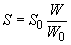,

где 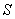 - расстояние от границы источника загрязнения до границы района с данной СЗ, скорректированное с учетом розы ветров, м;

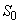 - нормированное расстояние от границы источника загрязнения до границы района с данной СЗ при круговой розе ветров, м;

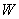 - среднегодовая повторяемость ветров рассматриваемого румба, %;

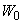 - повторяемость ветров одного румба при круговой розе ветров, %.

Значения 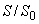 должны ограничиваться пределами 0,5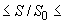2.

1.9.38. Степень загрязнения вблизи отвалов пылящих материалов, складских зданий и сооружений, канализационно-очистных сооружений следует определять по табл.1.9.14.

Таблица 1.9.14 

СЗ вблизи отвалов пылящих материалов, складских зданий

и сооружений, канализационно-очистных сооружений 

(золоотвалы, солеотвалы, шлакоотвалы, крупные промышленные свалки, предприятия по сжиганию 

мусора, склады и элеваторы пылящих материалов, склады для хранения минеральных удобрений 

и ядохимикатов, гидрошахты и обогатительные фабрики, станции аэрации и другие

канализацонно-очистные сооружения)

| #G0СЗ при расстоянии от источника загрязнения, м |  |  |
| --- | --- | --- |
| до 200 | от 200 до 600  | от 600  |
| 3  | 2  | 1 |

[Исходная структура таблицы](assets/table_0f734faefcbadda8.xml)

1.9.39. Степень загрязнения вблизи автодорог с интенсивным использованием в зимнее время химических противогололедных средств следует определять по табл.1.9.15.

Таблица 1.9.15 

СЗ вблизи автодорог с интенсивным использованием

в зимнее время химических противогололедных средств 

| #G0СЗ при расстоянии от автодорог, м |  |  |
| --- | --- | --- |
| до 25 | от 25 до 100  | от 100  |
| 3  | 2  | 1 |

[Исходная структура таблицы](assets/table_0f5f8a70bc594479.xml)

1.9.40. Степень загрязнения в прибрежной зоне морей, соленых озер и водоемов должна определяться по табл.1.9.16 в зависимости от солености воды и расстояния до береговой линии. Расчетная соленость воды определяется по гидрологическим картам как максимальное значение солености поверхностного слоя воды в зоне до 10 км вглубь акватории. Степень загрязнения над поверхностью засоленных водоемов следует принимать на одну ступень выше, чем в табл.1.9.16 для зоны до 0,1 км.

Таблица 1.9.16 

СЗ в прибрежной зоне морей и озер площадью более 10000 м 

| #G0Тип водоема | Расчетная соленость воды, г/л | Расстояние от береговой линии, км | СЗ  |
| --- | --- | --- | --- |
| Незасоленный  | До 2 | До 0,1  | 1  |
| Слабозасоленный  | От 2 до 10  | До 0,1 | 2  |
|  |  | От 0,1 до 1,0 | 1  |
| Среднезасоленный  | От 10 до 20  | До 0,1 | 3  |
|  |  | От 0,1 до 1,0 | 2  |
|  |  | От 1,0 до 5,0 | 1  |
| Сильнозасоленный  | От 20 до 40  | До 1,0 | 3  |
|  |  | От 1,0 до 5,0 | 2  |
|  |  | От 5,0 до 10,0 | 1  |

1.9.41. В районах, подверженных ветрам со скоростью более 30 м/с со стороны моря (периодичностью не реже одного раза в 10 лет), расстояния от береговой линии, приведенные в табл.1.9.16, следует увеличить в 3 раза.

Для водоемов площадью 1000-10000 м СЗ допускается снижать на одну ступень по сравнению с данными табл.1.9.16.

1.9.42. Степень загрязнения вблизи градирен или брызгальных бассейнов должна определяться по табл.1.9.17 при удельной проводимости циркуляционной воды менее 1000 мкСм/см и по табл.1.9.18 при удельной проводимости от 1000 до 3000 мкСм/см.

Таблица 1.9.17 

СЗ вблизи градирен и брызгальных бассейнов

с удельной проводимостью циркуляционной воды

менее 1000 мкСм/см 

| #G0СЗ района  | Расстояние от градирен (брызгального бассейна), м |  |
| --- | --- | --- |
|  | до 150 | от 150  |
| 1 | 2  | 1  |
| 2 | 3  | 2  |
| 3 | 4  | 3  |
| 4 | 4  | 4  |

[Исходная структура таблицы](assets/table_7c91176c8277eb88.xml)

Таблица 1.9.18 

СЗ вблизи градирен и брызгальных бассейнов

с удельной проводимостью циркуляционной воды

от 1000 до 3000 мкСм/см 

| #G0СЗ района  | Расстояние от градирен (брызгального бассейна), м |  |  |
| --- | --- | --- | --- |
|  | до 150 | от 150 до 600  | от 600  |
| 1 | 3  | 2  | 1  |
| 2 | 4  | 3  | 2  |
| 3 | 4  | 4  | 3  |
| 4 | 4  | 4  | 4  |

[Исходная структура таблицы](assets/table_00a3c57ac1894afe.xml)

1.9.43. Расчетную СЗ в зоне наложения загрязнений от двух независимых источников, определенную с учетом розы ветров по 1.9.37, следует определять по табл.1.9.19 независимо от вида промышленного или природного загрязнения.

Таблица 1.9.19 

Расчетная СЗ при наложении загрязнений

от двух независимых источников 

| #G0СЗ от первого источника  | Расчетная СЗ при степени загрязнения от второго источника  |  |  |
| --- | --- | --- | --- |
|  | 2  | 3  | 4 |
| 2 | 2  | 3  | 4  |
| 3 | 3  | 4  | 4  |
| 4 | 4  | 4  | 4  |

[Исходная структура таблицы](assets/table_6f11a1941df693b3.xml)

Коэффициенты использования основных типов

изоляторов и изоляционных конструкций

(стеклянных и фарфоровых)

1.9.44. Коэффициенты использования  изоляционных конструкций, составленных из однотипных изоляторов, следует определять как

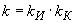,

где 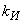 - коэффициент использования изолятора;

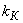 - коэффициент использования составной конструкции с параллельными или последовательно-параллельными ветвями.

1.9.45. Коэффициенты использования  подвесных тарельчатых изоляторов по #M12291 1200011857ГОСТ 27661#S со слабо развитой нижней поверхностью изоляционной детали следует определять по табл.1.9.20 в зависимости от отношения длины пути утечки изолятора 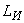 к диаметру его тарелки .

Таблица 1.9.20 

Коэффициенты использования  подвесных

тарельчатых изоляторов со слабо развитой

нижней поверхностью изоляционной детали 

| 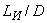 | #G0 |
| --- | --- |
| От 0,90 до 1,05 включительно | 1,00  |
| От 1,05 до 1,10 включительно | 1,05  |
| От 1,10 до 1,20 включительно | 1,10  |
| От 1,20 до 1,30 включительно | 1,15  |
| От 1,30 до 1,40 включительно | 1,20  |

1.9.46. Коэффициенты использования  подвесных тарельчатых изоляторов специального исполнения с сильно развитой поверхностью следует определять по табл.1.9.21. 

Таблица 1.9.21 

Коэффициенты использования 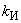 подвесных

тарельчатых изоляторов специального исполнения 

| #G0Конфигурация изолятора |   |
| --- | --- |
| Двукрылая | 1,20  |
| С увеличенным вылетом ребра на нижней поверхности | 1,25  |
| Аэродинамического профиля (конусная, полусферическая) | 1,0  |
| Колоколообразная с гладкой внутренней и ребристой наружной поверхностями | 1,15  |

1.9.47. Коэффициенты использования  штыревых изоляторов (линейных, опорных) со слабо развитой поверхностью должны приниматься равными 1,0, с сильно развитой поверхностью - 1,1.

1.9.48. Коэффициенты использования  внешней изоляции электрооборудования наружной установки, выполненной в виде одиночных изоляционных конструкций, в том числе опорных изоляторов наружной установки на номинальное напряжение до 110 кВ, а также подвесных изоляторов стержневого типа на номинальное напряжение 110 кВ, следует определять по табл.1.9.22 в зависимости от отношения длины пути утечки изолятора или изоляционной конструкции  к длине их изоляционной части 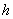.

Таблица 1.9.22 

Коэффициенты использования одиночных

изоляционных колонок, опорных

и подвесных стержневых изоляторов 

| #G0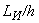  | менее 2,5  | 2,5-3,00  | 3,01-3,30  | 3,31-3,50  | 3,51-3,71  | 3,71-4,00 |
| --- | --- | --- | --- | --- | --- | --- |
|  | 1,0  | 1,10  | 1,15  | 1,20  | 1,25  | 1,30  |

1.9.49. Коэффициенты использования  одноцепных гирлянд и одиночных опорных колонок, составленных из однотипных изоляторов, следует принимать равными 1,0.

1.9.50. Коэффициенты использования  составных конструкций с параллельными ветвями (без перемычек), составленных из однотипных элементов (двухцепных и многоцепных поддерживающих и натяжных гирлянд, двух- и многостоечных колонок), следует определять по табл.1.9.23.

Таблица 1.9.23 

Коэффициенты использования  составных конструкций

с электрически параллельными ветвями (без перемычек)

| #G0Количество параллельных ветвей | 1  | 2 | 3-5  |
| --- | --- | --- | --- |
|  | 1,0  | 1,05  | 1,10  |

1.9.51. Коэффициенты использования -образных и 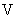-образных гирлянд с одноцепными ветвями следует принимать равными 1,0.

1.9.52. Коэффициенты использования  составных конструкций с последовательно-параллельными ветвями, составленными из изоляторов одного типа (гирлянд типа Y или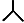, опорных колонок с различным числом параллельных ветвей по высоте, а также подстанционных аппаратов с растяжками), следует принимать равными 1,1.

1.9.53. Коэффициенты использования  одноцепных гирлянд и одиночных опорных колонок, составленных из разнотипных изоляторов с коэффициентами использования 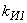 и 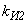, должны определяться по формуле

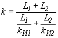,

где 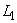 и 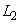 - длина пути утечки участков конструкции из изоляторов соответствующего типа. Аналогичным образом должна определяться величина 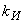 для конструкций указанного вида при числе разных типов изоляторов, большем двух.

1.9.54. Конфигурация подвесных изоляторов для районов с различными видами загрязнений должна выбираться по табл.1.9.24.

Таблица 1.9.24 

Рекомендуемые области применения подвесных изоляторов

различной конфигурации 

| #G0Конфигурация изолятора | Характеристика районов загрязнения  |
| --- | --- |
| Тарельчатый с ребристой нижней поверхностью (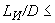1,4) | Районы с 1-2-й СЗ при любых видах загрязнения  |
| Тарельчатый гладкий полусферический, тарельчатый гладкий конусный | Районы с 1-2-й СЗ при любых видах загрязнения, районы с засоленными почвами и с промышленными загрязнениями не выше 3-й СЗ |
| Тарельчатый фарфоровый  | Районы с 4-й СЗ вблизи цементных и сланцевоперерабатывающих предприятий, предприятий черной металлургии, предприятий по производству калийных удобрений, химических производств, выпускающих фосфаты, алюминиевых заводов при наличии  цехов производства электродов (цехов анодной массы) |
| Стержневой фарфоровый нормального исполнения (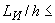2,5) | Районы с 1-й СЗ, в том числе с труднодоступными трассами ВЛ |
| Тарельчатый двукрылый  | Районы с засоленными почвами и с промышленными загрязнениями (2-4-я СЗ) |
| Тарельчатый с сильно выступающим ребром на нижней поверхности (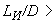1,4) | Побережья морей и соленых озер (2-4-я СЗ) |
| Стержневой фарфоровый специального исполнения (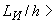2,5) | Районы с 2-4-й СЗ при любых видах загрязнения; районы с труднодоступными трассами ВЛ (2-3-я СЗ) |
| Стержневой полимерный нормального исполнения  | Районы с 1-2-й СЗ при любых видах загрязнения, в том числе районы с труднодоступными трассами ВЛ |
| Стержневой полимерный специального исполнения | Районы с 2-3-й СЗ при любых видах загрязнения, в том числе районы с труднодоступными трассами ВЛ |

Примечание.  - диаметр тарельчатого изолятора, см;  - высота изоляционной части стержневого изолятора, см;  - длина пути утечки, см.

Текст документа сверен по:

нормативно-производственное издание

М.: Издательство НЦ ЭНАС, 2002 
